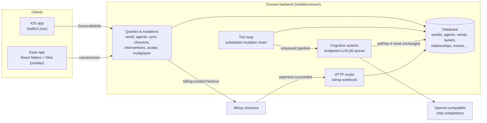

# Living Moon

A god-mode life sim for your phone. You are an unseen force watching over **Shackleton Colony**, a
settlement of 100 autonomous colonists on the Moon. Each colonist has needs, traits, values, goals,
beliefs and relationships, and lives their own life: they work shifts, eat, sleep, trade, gossip,
steal, petition the council and mourn their dead. You never control anyone directly. You cause
things to happen (a drought at the ice wells, a meteor storm, a whispered idea, a rumor, a new
arrival) and watch the consequences ripple through the colony.

An LLM gives colonists richer plans and speech, but the world never waits for it: rules decide what
actually happens, the model only proposes, and the colony keeps running on rule-based plans when no
model is configured.

You can also put **yourself** into the colony. Import what your apps know about you, build a colonist
from it, tell it what you want, and invite friends into the same world with their own avatars.

## Demo

[Watch the demo video](docs/demo.mp4): the team and the live iPhone app, side by side.

## Contents

- [Demo](#demo)
- [What you can do](#what-you-can-do)
- [How it works](#how-it-works)
- [Repository layout](#repository-layout)
- [Getting started](#getting-started)
- [Configuration](#configuration)
- [Testing](#testing)
- [The backend API](#the-backend-api)
- [Monetisation](#monetisation)
- [Privacy](#privacy)
- [Further reading](#further-reading)

## What you can do

### Watch the colony

The colony is a top-down pixel-art map of 14 locations joined by pressurised tubes and exposed
surface routes: the Commons Plaza, Exchange Concourse, Airlock Canteen, Hydroponics Bays, Supply
Depot, Fabrication Works, Med Bay, two habitat rings, the Ice Wells, Regolith Quarry, Solar Farm,
Observatory Lab and Landing Pad. Time runs in 10-minute ticks (one simulated sol is about 8 real
minutes at 1x), with speeds of paused, 1x, 4x and 8x, and a **skip to the next notable event**
button that fast-forwards up to six simulated hours.

The colony economy runs on five resources: food, water, parts, medicine and credits. Water is the
scarce one, so colonists have a **thirst** need alongside hunger, fatigue, safety and social. Market
prices rise as public stock falls.

The app has four views:

| Tab | What it shows |
|---|---|
| **Colony** | The live map with a HUD for the clock, colony stockpiles and god powers. Tap a colonist to inspect them, or follow one to ride along with their day. |
| **People** | Every colonist, alive or dead, with their occupation, mood and needs. |
| **Chronicle** | A feed of what happened, filtered by salience. Tap an event to see its **cause chain**: the ancestors that led to it and the effects it set off. |
| **You** (iOS) | Your own avatar, its profile, the directives you have given it, and your friends in this world. |

The inspector shows a colonist's needs, traits, beliefs, relationships and current plan. On iOS a
"mind lens" shows thought bubbles over colonists' heads and a card with their latest thought, what
set it off and the plan it led to.

### Use god powers

Every power is free and goes through one validated, idempotent endpoint. Powers never write
outcomes directly; they change conditions and let the simulation play out the consequences.

| Power | Effect |
|---|---|
| **Drought** | The ice wells run dry. Water output falls, then hydroponics yield falls with it. |
| **Storm** | A solar or meteor storm hits exposed surface sites: it damages buildings, blocks surface routes and injures anyone caught outside. |
| **Grant** | Give a colonist food, water, parts, medicine or credits. |
| **Kill** | A colonist dies by accident, illness or suit failure. Friends and family grieve. |
| **Whisper** | Plant an idea in one mind: suspect someone of hoarding, distrust or befriend them, seek a council seat, get rich, share what you have, or write your own. |
| **Rumor** | Start a rumor about a colonist (hoarder, thief, saboteur, corrupt, quiet hero, or your own text). It spreads person to person when colonists talk. |
| **Create character** | Design a new colonist and land them at the Landing Pad. |

On iOS each power plays a full-screen cinematic showing who reacted and how.

### Bring yourself into the world (iOS)

1. **Import.** Pick any mix of sources: Gmail (signed in on device with OAuth; only sender domains,
   subject lines and labels are read, never bodies or addresses), the answer your own assistant
   (ChatGPT, Claude or Gemini) gives to a fixed "what do you know about me" prompt, or free text.
   Only a digest you have read leaves the phone.
2. **Build.** The backend turns your sources into a profile: job, traits, values, backstory,
   interests, speech style, habits and goals. You can edit it before spawning.
3. **Spawn.** Your avatar lands at the Landing Pad. Friends' avatars already in the world start out
   as its friends.
4. **Direct.** Tell it what you want ("go make friends with the medics") and it becomes the avatar's
   top goal and an immediate plan, refined by the LLM when it answers.
5. **Play with friends.** The host shares a 6-character invite code; up to 8 players can share one
   world. Other players can't kill your avatar or whisper to it; only you guide it.

## How it works



**One canonical world on the backend.** Each app install gets a session and its own world, seeded
with 100 colonists (18 hand-authored key characters who carry the starting tensions, plus generated
households). The population is capped at 120.

**The world ticks only while someone is watching.** Clients send a heartbeat every ~15 seconds. While
a heartbeat is fresh (60 seconds), a self-rescheduling Convex mutation advances the world one tick at
a time. Agents are scheduled by next-due time, so a tick only touches colonists whose current activity
just ended rather than all 100. Close the app and the world pauses.

**Rules decide, the LLM proposes.** Colonists act through a fixed table of plan steps (`go`, `work`,
`eat`, `drink`, `sleep`, `ration`, `buy`, `sell`, `talk`, `give`, `steal`, `help`,
`investigate`, `accuse`, `petition`, `repair`, `mourn`, `flee`, `wait`, ...). The simulation
executes every step and decides whether it succeeds. When a colonist would benefit from deeper
reasoning, the simulation queues a cognition job and carries on with a rule-based plan. The cognition
action builds a compact context from what that colonist actually perceives, asks the model for a
plan, validates the output against the step table, and commits it only if the colonist's mind has
not changed since the job was queued.

**LLM calls are sparse and budgeted.** Each world has a daily call budget (40 plans per sol by
default, 3 concurrent) with reserves held back for the colonist you are following and for reactions to
big events, plus a small separate allowance for speech. Failed calls back off and the world keeps
running on rules.

**Clients stay smooth with little traffic.** Clients subscribe reactively to `world:get` (which
doubles as the clock), load `agents:list` once, then pull `sync:updates` for only the rows that
changed since their last world version. Movement is sent as `{ from, to, departTick, arriveTick }`
and animated on device along the shared path-finder, so walking colonists need no per-frame backend
traffic.

**Everything has a cause.** Events record the event that caused them, so the Chronicle can show the
whole chain from a drought to the water shortage, the theft, the accusation and the council
petition that followed.

## Repository layout

```
README.md                 this file
docs/ARCHITECTURE.md      design decisions, ownership and how the pieces talk
hackathon.md              build log
ios/                      native SwiftUI client (Xcode project "LivingMoon")
  LivingMoon/
    LivingMoonApp.swift   app entry, tabs, sheets and overlays
    Game.swift            app state; picks the live or offline source
    Contract.swift        Swift mirror of mobile/shared/types.ts
    WorldSource.swift     the backend seam (one method per API entry)
    ConvexSource.swift    WorldSource over the Convex deployment
    MockSource.swift      offline colony that runs on device
    MapView.swift         the colony map
    Screens.swift         Colony, People, Chronicle, inspector, powers, follow, patron
    Cinematics.swift      full-screen power cinematics
    Mind.swift            thought bubbles and the mind lens
    YouView.swift         avatar import, profile, directives and friends
    GoogleAuth.swift      Gmail OAuth (PKCE) and on-device digest
    Onboarding.swift      first-run flow with a playable taste of the powers
    Art/                  pixel art for buildings and colonists
mobile/                   Expo app and the Convex backend
  App.tsx, index.ts       Expo entry
  shared/                 the contract, imported by both backend and client
    colony.ts             clock, resources, locations, routes, occupations, presets, findPath
    types.ts              public data shapes (agents, world, events, powers, avatars)
    api.ts                every public Convex function: path, args and return type
    mapLayout.ts          pixel geometry of the map
    assets.ts             art manifest type
  convex/                 backend
    schema.ts             tables
    session.ts            bootstrap, heartbeat, focus
    world.ts, sim.ts      world queries, speed, skip, and the tick entry point
    engine/               simulation core (transactions, events, beliefs, plans) and tick loop
    agents.ts, sync.ts, chronicle.ts   read API
    interventions.ts      god power endpoint
    powers/               one module per power family
    cognition.ts, cognition/   LLM job queue, budget, context, prompts, provider, validation
    avatar.ts, avatar/    player avatars: sources, profile synthesis, spawn, directives
    multiplayer.ts        invite, join, leave
    billing.ts, http.ts   Whop checkout and webhook
    seed/                 world generation and key characters
    lib/                  auth, constants, RNG, helpers
    *.test.ts             in-memory backend tests
  src/                    Expo client
    data/                 WorldSource interface, Convex source and mock source
    game/                 game store, animation and geometry
    render/               Skia world renderer
    ui/                   HUD, tabs, sheets, chronicle, patron
    art/                  the one place the client gets its art manifest from
    dev/placeholderArt/   generated placeholder art and its generator script
```

## Getting started

### Prerequisites

- Node.js and npm
- A [Convex](https://convex.dev) account, if you want to run your own backend
- Xcode 26 or later for the iOS app (it targets iOS 26)

### Backend (Convex)

```bash
cd mobile
npm install
npx convex dev        # creates or links a dev deployment, pushes functions, and watches for changes
```

Set the backend environment variables in the Convex dashboard (or with `npx convex env set NAME value`).
None are required to run the simulation; see [Configuration](#configuration).

### Expo app

```bash
cd mobile
cp .env.example .env  # then set EXPO_PUBLIC_CONVEX_URL to your deployment URL
npm install
npx expo start        # press i for iOS simulator, a for Android, w for web
```

To run without any backend, set `EXPO_PUBLIC_DATA_SOURCE=mock` (or leave
`EXPO_PUBLIC_CONVEX_URL` unset) and the app runs a fake colony locally.

The app uses native modules (Skia, Reanimated, Gesture Handler), so if something is missing from
Expo Go, use a development build: `npx expo run:ios` / `npx expo run:android`, or
`eas build --profile development`.

### iOS app

1. Open `ios/LivingMoon.xcodeproj` in Xcode. Swift Package Manager fetches
   [convex-swift](https://github.com/get-convex/convex-swift) on first open.
2. Pick a simulator or device and run the `LivingMoon` scheme.

The app starts on the **offline colony** (`MockSource`), which runs entirely on device. To connect
to the live backend, open the menu on the Colony tab and turn on **Live backend**. The deployment URL
is `Game.convexURL` in `ios/LivingMoon/Game.swift`; change it to point at your own deployment.

Gmail import is disabled until you set `GoogleAuth.clientID` in
`ios/LivingMoon/GoogleAuth.swift` to an iOS OAuth client id from Google Cloud Console (with the
`gmail.readonly` scope). The other import sources work without it.

## Configuration

### Convex deployment environment

| Variable | Required | Purpose |
|---|---|---|
| `LLM_API_KEY` | No | Enables LLM cognition. Without it, every colonist runs on rule-based plans and avatar profiles are built with keyword rules. |
| `LLM_BASE_URL` | No | Any OpenAI-compatible endpoint. Defaults to `https://api.openai.com/v1`. OpenAI gets strict structured output; other providers get JSON mode. |
| `LLM_MODEL` | No | Defaults to `gpt-6-luna`. |
| `LLM_REASONING_EFFORT` | No | For reasoning models. Defaults to `none` for the default model. |
| `WHOP_API_KEY` | For payments | Creates Colony Pass checkouts. |
| `WHOP_ENVIRONMENT` | No | `production` for live payments; anything else uses the Whop sandbox. |
| `WHOP_WEBHOOK_SECRET` | For payments | Verifies the signature on `POST /whop`. |

Tuning numbers (starting stockpiles, prices, LLM budget, rate limits) live in
`mobile/convex/lib/constants.ts`.

### Expo app environment (`mobile/.env`)

| Variable | Purpose |
|---|---|
| `EXPO_PUBLIC_CONVEX_URL` | Your Convex deployment URL, e.g. `https://<name>.convex.cloud`. |
| `EXPO_PUBLIC_DATA_SOURCE` | `convex` for the live backend or `mock` for the local fake world. Defaults to `convex` when the URL is set. |

## Testing

Backend tests run fully in memory with [vitest](https://vitest.dev) and
[convex-test](https://www.npmjs.com/package/convex-test); no deployment is needed.

```bash
cd mobile
npm test              # vitest run
npm run typecheck     # tsc --noEmit
```

The suite covers the simulation core, every god power, `sync:updates` and the chronicle, the
cognition queue (budgets, validation, back-off), and avatars. One live test sends a real prompt to
the configured model; it is skipped unless you opt in:

```bash
LLM_LIVE=1 LLM_API_KEY=... npm test
```

## The backend API

Every public Convex function is declared, with argument and return types, in
[`mobile/shared/api.ts`](mobile/shared/api.ts). The Expo client calls them through the generated
`api` object and the iOS client by path string. Because they are ordinary Convex functions, any other
client can call them over Convex's HTTP API too.

| Group | Functions |
|---|---|
| Session | `session:bootstrap`, `session:heartbeat`, `session:setFocus` |
| World | `world:get`, `world:setSpeed`, `world:skipToNotable`, `world:reset` |
| Agents | `agents:list`, `agents:get` |
| Sync | `sync:updates` |
| Chronicle | `chronicle:feed`, `chronicle:chain` |
| God powers | `interventions:apply` (validated, rate-limited, idempotent on `commandId`) |
| Avatar | `avatar:mine`, `avatar:addSource`, `avatar:removeSource`, `avatar:synthesize`, `avatar:saveProfile`, `avatar:spawn`, `avatar:direct`, `avatar:forget` |
| Multiplayer | `multiplayer:state`, `multiplayer:setName`, `multiplayer:invite`, `multiplayer:join`, `multiplayer:leave` |
| Billing | `billing:status`, `billing:createCheckout` |

A session token from `session:bootstrap` authorises every mutation. There are no user accounts;
a session belongs to one install's device id.

## Monetisation

Every god power is free. The **Colony Pass** is a one-time $4.99 purchase through
[Whop](https://whop.com): `billing:createCheckout` creates a checkout tagged with the session, the
app opens Whop's hosted page, and Whop's `payment.succeeded` webhook hits `POST /whop` on the
Convex deployment, which marks the session premium. `billing:status` is reactive, so the app updates
as soon as the payment lands.

The patron screen advertises deeper minds, offline catch-up, a larger colony and multiple colonies.
Today the backend records the premium flag; those perks are not yet enforced by the simulation.

## Privacy

- Gmail is read on device with a short-lived token that is never stored or sent to the backend.
  Only sender domains, subject lines and labels are digested, never bodies or addresses, and the
  player sees the digest before it is sent.
- The backend scrubs email addresses, phone numbers and links from every source again before
  storing it, keeps at most 6 sources per player, and `avatar:forget` deletes all of them along
  with the profile.
- Colonists, including avatars, only know what they have perceived in the world. The LLM sees a
  compact context for one colonist at a time.

## Further reading

- [`docs/ARCHITECTURE.md`](docs/ARCHITECTURE.md): design decisions, how the backend parts meet,
  and the avatar and multiplayer design.
- [`mobile/shared/api.ts`](mobile/shared/api.ts) and [`mobile/shared/types.ts`](mobile/shared/types.ts):
  the full client-backend contract.
- [`mobile/convex/engine/core.ts`](mobile/convex/engine/core.ts): the simulation primitives and the
  table of legal plan steps.
